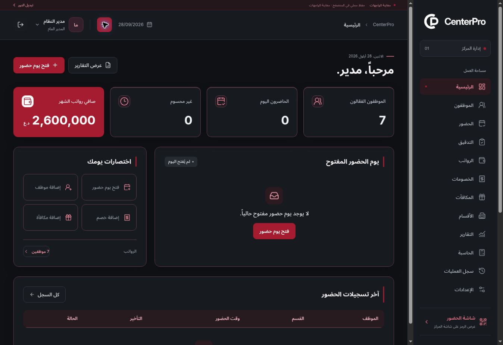
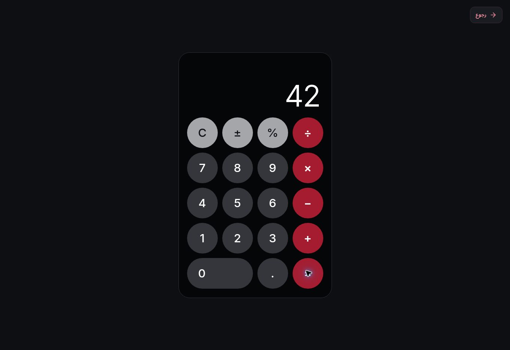

# Final UI, calculator and rank fix — Phase 1 Preview

## Supplied patch

- Attachment: `CenterPro_final_ui_calculator_rank_fix(1).patch`.
- Exact archive: [final-ui-calculator-rank-fix.patch](patches/final-ui-calculator-rank-fix.patch).
- SHA-256: `aba0f2aab8233b31daf7c361e11a39edb637288230b973285d57a4df36849607`.
- Base commit: `5d3ff5fcfcf30e10b7ec5a1514b2bcdf05c3dba3`.

## Implemented changes

- Added the standalone calculator to every account, including both administrator roles. It inherits light/dark mode, supports touch and keyboard input, and shows only the calculator and return control.
- Changed the administrator greeting to `مرحباً`.
- Applied the supplied crimson accents, borders and KPI icon contrast correction.
- Replaced all 22 rank images with the supplied 1024×1024 transparent assets and increased large-badge sizing.
- Used the exact approved brand artwork in the welcome screen to keep the CP symbol complete, while preserving its three-second post-login lifecycle and reduced-motion support.

## Integration and verification

- Confined the new shared brand styling to screen media, preserving compact report print styles.
- Kept normal KPI icons legible in dark mode and removed the duplicate legacy heading marker after adding the new crimson border.
- Made the calculator keypad explicitly left-to-right, fitted long results to its display, preserved touch targets and added visible keyboard focus.
- Kept the calculator return path inside the application with an explicit originating route and a role-home fallback for direct entry.
- Preserved native focused-button keyboard activation and browser modifier shortcuts.
- Verified that all 22 rank files match the patch's Git blob hashes, decode as 1024×1024 RGBA and have transparent outer margins. Supplied image bytes were not altered.

- Local lint, strict typecheck, 196 unit/domain tests and the production build passed.
- All 138 local browser scenarios passed: 126 existing/updated regression scenarios (8.5 minutes) and 12 calculator scenarios (51 seconds). Coverage includes all roles, arithmetic and keyboard behavior, safe return navigation, long-number layouts, all 22 rank images, welcome lifecycle, eight responsive widths, light/dark accessibility and report printing.
- Application commit: `10d2f34cc1df7fbe01e1cf7363b50ddef1370d34`, pushed to `main` and `preview/ui-approval`.

- [GitHub quality run 38143108810](https://github.com/Hussam9329/CenterPro/actions/runs/38143108810) completed successfully against the exact application commit. CI logs confirm 196 unit/domain tests and all 138 browser scenarios passed (6.0 minutes), alongside lint, strict typecheck and production build.

## Live Preview evidence

- Verified entry URL: https://centerpro-r9np6ge4c-hussam9329s-projects.vercel.app/login
- Vercel deployment: `dpl_4R7UzWaFQd66Cc977ey8LazC8fdz`, status `READY`, target `null` (Preview), source commit `10d2f34cc1df7fbe01e1cf7363b50ddef1370d34`.
- Deployment uploaded 117 source files (114 unique contents), using Vercel's content-addressed upload API; supplied rank images retain their exact bytes.
- Checked the published build through the visible browser UI: loaded the offered mock data, signed into the mock administrator account, observed the approved welcome logo and completed transition to the dashboard with `مرحباً، مدير.`.
- Checked the dark dashboard's crimson card borders and legible KPI icons, then opened the standalone calculator from navigation and verified `6 × 7 = 42`.
- Confirmed that the calculator inherited dark mode and that its return button navigated back to the originating dashboard.
- Selected screenshots from that exact Preview:

This remains the frontend approval phase. No Neon connection, production authentication, database mutation, financial persistence or real QR validation was added. No new Vercel environment variables are required.
