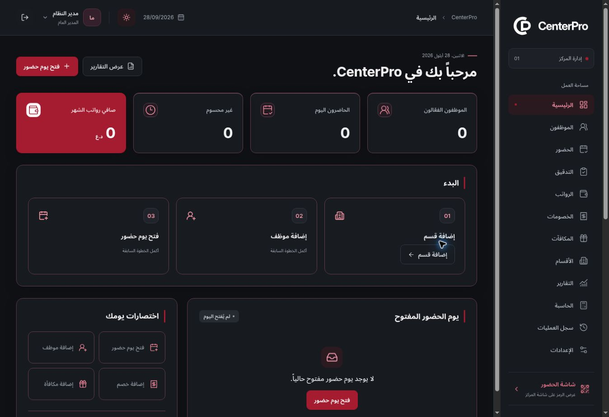
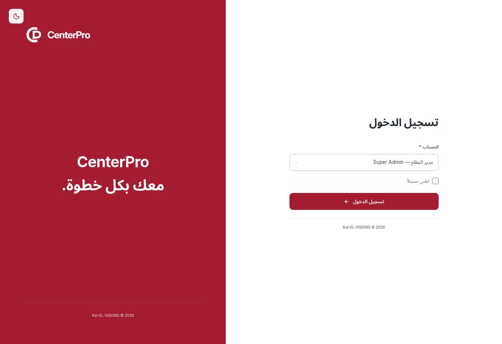

# Cleanup and dark welcome patch — October 11, 2026

## Supplied patch

The owner supplied `CenterPro_production_cleanup_dark_welcome_fix(1).patch` and requested the complete project on `main`. The exact attachment is archived at [patches/production-cleanup-dark-welcome.patch](patches/production-cleanup-dark-welcome.patch).

SHA-256: `bcb7b8b5e2ce07a1cd3fd84b19ec37dfedb4464fc1cd02bf9a09e3e6a0183b1d`.

All 12 file changes applied without conflicts. Additional changes only align regression tests and documentation with the supplied behavior.

## Delivered behavior

- The login fixture loader and its provider API are removed. A clean installation lists only the independent system administrator; operational collections begin empty.
- Browser state moves to version 4. Historical session keys v1/v2/v3 and remembered/data v1 keys are deleted on initialization instead of restoring older preview data, as expressly required by the patch. Newly created version-4 records remain intact on reload and through the supported remembered-session lifecycle.
- The preview strip is removed, metadata uses the application name, and Settings uses the requested system/reset wording. Reset retains its typed confirmation and clears all operational collections.
- The root layout no longer substitutes a holding screen when `VERCEL_ENV=production`. This is a rendering change only.
- The three-second login welcome always has a white background, the approved colored `/brand/logo.svg`, and dark text. The application retains its saved light/dark choice after the welcome and reload. Reduced-motion timing is unchanged.
- The account-switch regression test now uses the visible logout/login flow. Existing tests additionally verify new records survive reload and dark mode returns after the welcome.

## Verification

Local lint, strict typecheck, all 196 unit/domain tests and production build pass. The first full browser run passed 135 of 136 tests. Its only failure was a new test assertion using an obsolete dark canvas color (`#101216`) instead of the current authored `#0f1115`; the application was correct. The test-only follow-up updates that expectation. All 13 welcome tests then passed, covering all eight responsive widths, the exact three-second lifecycle, reduced motion and theme restoration. The final exact-commit [GitHub run 38151619261](https://github.com/Hussam9329/CenterPro/actions/runs/38151619261) on `3e1e87d4d64eea30b31dd296a18b376a651cdfc1` completed successfully: lint, strict typecheck, all 196 unit/domain tests, production build and all 136 browser scenarios. No test was skipped. The two removed scenarios tested the superseded legacy-store migration; the supplied patch replaces that behavior with explicit cleanup checks.

## Verified deployment

- Application source: `d300957456944dda9f4e6a65c21248e4d2521e2b`.
- Test-only follow-up on `main`: `3e1e87d4d64eea30b31dd296a18b376a651cdfc1`.
- Preview: https://centerpro-1ryusvhfm-hussam9329s-projects.vercel.app/login
- Deployment: `dpl_CwrKRpAixMifsBFdeP31aZVfuXfj`, status `READY`, target `null` (Preview).
- All 121 deployment input files are identical between the application and test-only commits; source size is 11,453,554 bytes and the manifest SHA-256 is `d08ec5b8bbef4c04c0618acd186f8d57fd703d5eb604cf252fc460c90ef55cd8`. No additional application deployment is needed for a test-only expectation correction.

Live browser verification confirmed one system account with no fixture loader, zero employees/attendance/payroll on the dashboard, no preview strip, the white welcome under dark mode, and the dark application after completion. The dashboard screenshot below comes from the live Preview; the mobile welcome screenshot comes from the passing 390px automated test with reduced motion.

## Production deployment authorization — October 11, 2026

After the Preview handoff, the owner explicitly requested deployment of `main` to Vercel Production. That instruction supersedes the earlier Preview-only hosting restriction. It changes the hosting target; the backend integration phase remains deferred.

- Production source on `main`: `9d4e44af68be55b92d9379c992e100e19c0a10c6`.
- Deployment: `dpl_8Gyx8JSYV1FUYyCSuVrpFuaPb1UT`, status `READY`, target `production`; the project's current Production deployment ID matches.
- Verified canonical URL: https://centerpro-sigma.vercel.app/login
- Deployment URL: https://centerpro-osfirqji4-hussam9329s-projects.vercel.app
- Vercel confirms the assigned domains `centerpro-sigma.vercel.app` and `centerpro-hussam9329s-projects.vercel.app`, with no alias error.
- All 121 deployment input files remain byte-for-byte identical to the verified Preview and tested application: 11,453,554 bytes, manifest SHA-256 `d08ec5b8bbef4c04c0618acd186f8d57fd703d5eb604cf252fc460c90ef55cd8`.
- No application code changed for this deployment. The existing passing lint, typecheck, 196 unit tests, 136 browser scenarios and production build apply to the same application inputs; no new test run is claimed here.

Live browser verification opened the canonical Production URL and confirmed that the login screen renders with its login action enabled.

## Scope and environment

This remains the current frontend-only build with browser-local state, name-based simulated login and simulated QR validation. The patch does not authorize or implement the deferred Neon/authentication/backend phase. No Neon connection or database mutation was made. Payroll, attendance and evaluation formulas and the approved rank artwork are unchanged.

No environment variables are required for this revision. GitHub/Vercel credentials are used outside the repository for release actions only; none are included in the application or patch archive.
