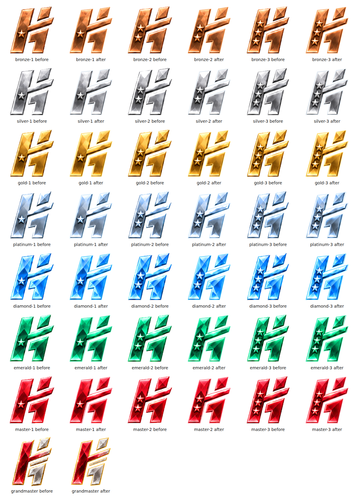
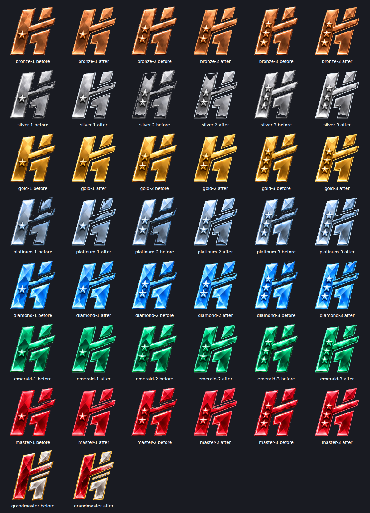
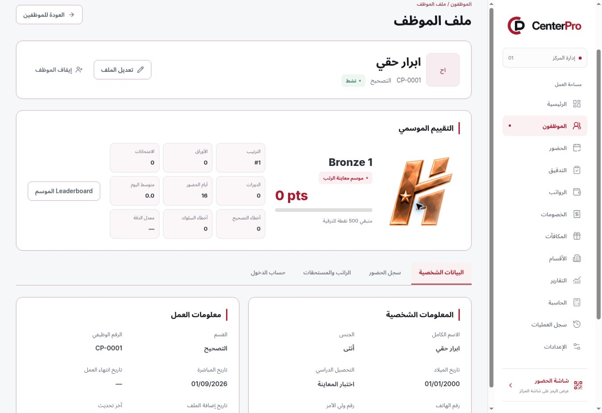
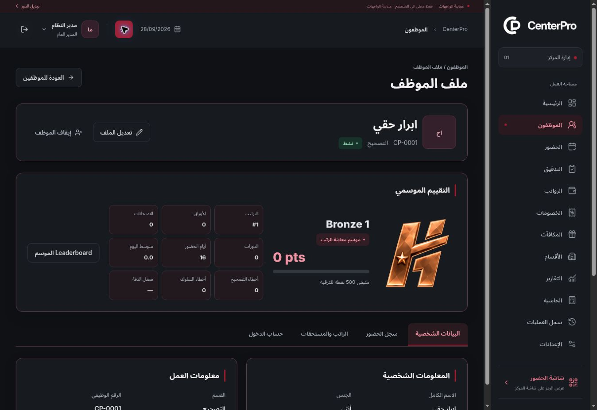

# Rank edge fix — Phase 1 Preview

## Supplied patch

- Attachment: `CenterPro_rank_edge_final_fix(1).patch`.
- Exact archive: [rank-edge-final-fix.patch](patches/rank-edge-final-fix.patch).
- SHA-256: `fad05d9b350b7b353b3d18988bb7e214d5234213fa80a3021bc86b51f4f4a32e`.
- Base: `8081944951d38196ce5212d7ce7eddba2673be49`.

## Implementation

- Applied the supplied shared SVG silhouette masks, tier-colored outline layer and matching shine mask.
- The attachment referenced four SVG files without including them. Added these required native vector resources under `public/ranks/`, aligned with the existing 1024px artwork, with a separate silhouette and outline for Grandmaster.
- Preserved all 22 supplied PNG files unchanged, rank thresholds, evaluation scores, responsive badge sizes and reduced-motion behavior.
- Strengthened the existing rank regression tests to fetch and decode every real mask, check correct normal/Grandmaster assignment, alignment, visible content retention and connected outlines. Correct-looking CSS URLs alone cannot detect missing mask files.

## Asset geometry review

All 22 badges were compared before and after in light and dark themes at a rendered size of 176px. The supplied PNG silhouettes differ slightly between tiers; a shared clean vector perimeter necessarily trims their rough margins. Browser alpha-weighted measurements retain 86.85–91.94% of original painted alpha (Grandmaster: 89.54%). Tests use an 85% severe-clipping guard together with actual SVG decoding, exact tier mapping, nonempty masks, matching bounds and connected outlines. The original PNG bytes and their internal transparent regions remain unchanged.

## Verification

Local lint, strict typecheck, all 196 unit/domain tests and the production build passed.

- All 138 local browser scenarios passed across the regression runs: 115 unaffected flows, 20 other affected flows and all 3 rank scenarios. Rank coverage includes actual loading of all four SVG masks, all 22 PNGs, the separate Grandmaster silhouette, both themes and reduced motion. Responsive and dark-mode regression coverage spans eight viewport widths.
- The initial binary-pixel outline-area check overcounted antialiased edge pixels on Grandmaster (21.01%); the corrected alpha-weighted measure is 16.74%, below the unchanged 20% thin-edge limit. All 3 native rank scenarios passed after this test-only correction. Lint and strict typecheck passed again.
- Application patch commit: `77b4dc6682e043bd9c5005918e879267e683bbd0`.
- Final verification source commit: `39642a98dcd5774b3eb16f0fe5a46c367ed00a03`, pushed to `main` and `preview/ui-approval`.

- [GitHub CI run 38148117576](https://github.com/Hussam9329/CenterPro/actions/runs/38148117576) completed successfully for the exact final source commit. All quality steps passed; its logs confirm 196 unit/domain tests and all 138 browser scenarios passed (5.6 minutes), with no failed or flaky summary.

## Live Preview

- Browser-verified entry URL: https://centerpro-1knppsy9v-hussam9329s-projects.vercel.app/login
- Deployment `dpl_BQS5wQbTWUkAvdMJ18BVeUZutZtr`: `READY`, Preview target `null`, exact source `39642a98dcd5774b3eb16f0fe5a46c367ed00a03`.
- Release uploaded 121 source files (118 unique contents), 11,455,848 bytes. Manifest SHA-256: `fdd81736d08832a71628ee1dc66883a31c7accf43aae3a7e5eadc28758c032cb`.
- Used the visible Preview UI to load its optional mock accounts, sign into the mock administrator account and open a local `موسم معاينة الرتب` season. Opened the seasonal leaderboard and verified the large corrector-profile rank in both themes.
- The screenshots below show that exact published build. No real account, database or financial records were modified.

This is the frontend approval phase only. No new Vercel environment variables are required.
